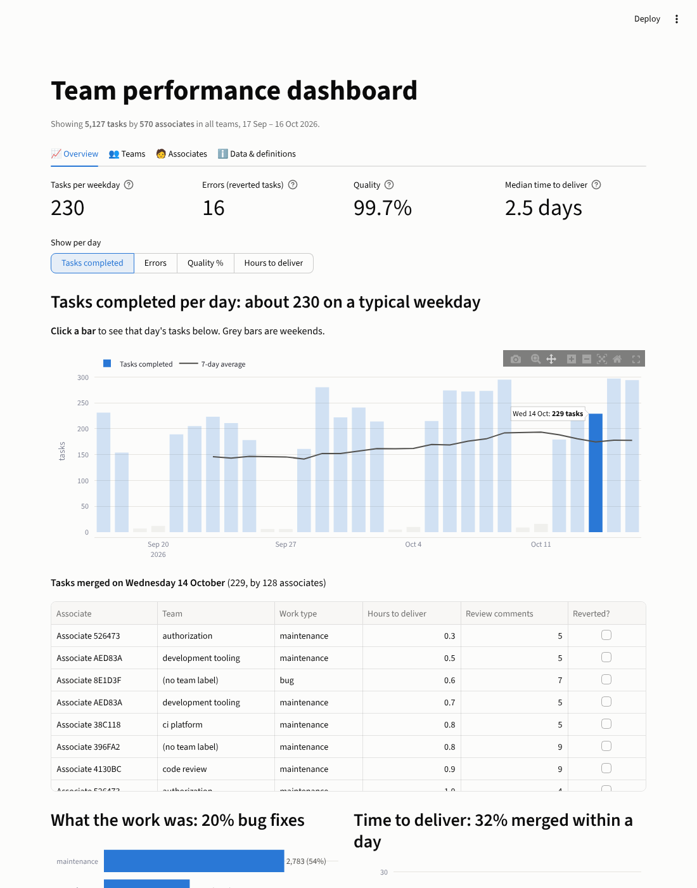
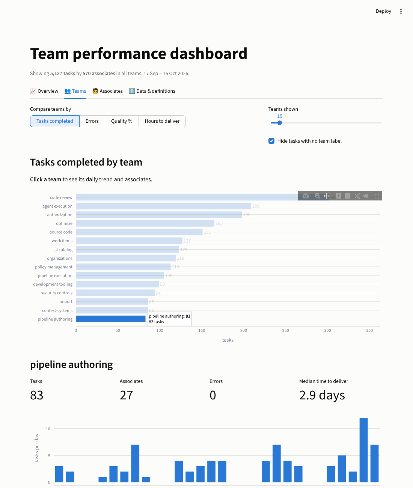
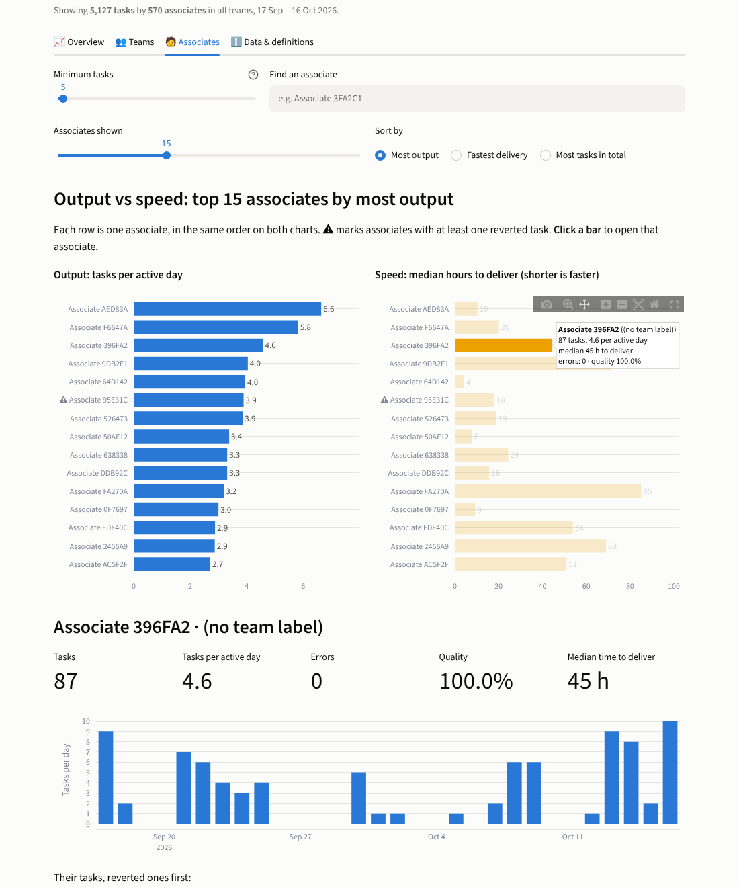

# Team performance: a GitLab API → SQLite → interactive dashboard pipeline

This project measures how an engineering team performs, using real public data:

| Question | Metric |
|---|---|
| How many tasks does the team / each associate complete per day? | **Tasks completed**: merged merge requests (MRs) |
| How many errors happen per day? | **Errors**: tasks that later had to be *reverted* (undone) |
| What is each associate's quality? | **Quality %**: share of their tasks that were never reverted |
| How much time does an associate spend on a task? | **Time to deliver**: hours from opening a task to finishing it |



## Setup

**API:** the GitLab REST API (`https://gitlab.com/api/v4`), project **`gitlab-org/gitlab`**.
**No API key or account needed.** A personal token is optional and only raises rate limits.

```bash
python -m venv .venv && source .venv/bin/activate
pip install -r requirements.txt

python run_pipeline.py              # first run: last 30 days, ~75 requests, ~3 minutes
streamlit run dashboard/app.py      # opens http://localhost:8501

python -m pytest                    # offline tests, no network needed
```

Other options:

```bash
python run_pipeline.py --every 360      # simple schedule: run every 6 hours
python run_pipeline.py --transform-only # rebuild all tables from raw data, no API calls
python run_pipeline.py --full-refresh   # re-download every day in the window
LOOKBACK_DAYS=60 python run_pipeline.py # load a longer history
GITLAB_TOKEN=glpat-... python run_pipeline.py   # optional, higher rate limits
```

## Why this API

Real per-employee productivity data is almost never public. GitLab develops its own product in the open, so **every task, review and revert by a large team (570 people in 30 days) is visible through a free API**. It has the structure a team-performance view needs:

* a **task** with a start and an end: a merge request, opened and then merged;
* a **team**: GitLab labels each task with the owning team, for example `group::code review`;
* a **work type** (`type::feature`, `type::bug`, `type::maintenance`);
* a visible **error** signal: a task that had to be reverted;
* a built-in **time-tracking** field (which turned out to be empty; see below).

It is also a realistic "unreliable source": paged results, two rate limiters that disagree, missing fields and occasional bad responses.

## Data model

```
GitLab API
   │  pipeline/client.py    retries, rate limits, paging
   ▼
RAW        raw_mr_pages      whole JSON responses, append-only, one load per day
           ingest_days       which days are loaded, and GitLab's own count for each
           ingest_runs       a log of every run: status, requests, problems
   │  pipeline/transform.py  (Python: the fiddly parsing)
   ▼
STAGING    stg_merge_requests  one clean row per MR: typed, deduplicated, ANONYMISED
           stg_reverts         each revert linked to the task it undid
   │  sql/*.sql              (plain SQL: simple SELECT ... GROUP BY)
   ▼
REPORTING  fct_tasks         one row per completed task (bots and reverts left out)
           mart_daily        tasks and errors per team per day
           mart_associates   per associate: tasks/day, errors, quality, time
           mart_teams        per team for the whole period
           dq_checks         what's missing or doubtful
```

**The SQL is deliberately simple.** Each file in `sql/` is one commented query of the form `SELECT ... GROUP BY`. The hard parts are done in Python before the SQL runs, so the SQL never needs window functions or tricky joins:
* hashing names into anonymous IDs;
* parsing revert titles;
* matching each revert to the task it undid.

SQLite has no `MEDIAN`, so the pipeline registers one, and the SQL can say `MEDIAN(cycle_hours)`. Reporting tables are written as real tables (`CREATE TABLE AS`), so they open in any SQLite tool.

## Handling a live, unreliable API

Every row below comes from the live API while building this:

| Reality | What the pipeline does |
|---|---|
| **Paging**: about 300 MRs merge on a busy day, at most 100 per page | Load one day at a time (`merged_after` / `merged_before`) and follow GitLab's `X-Next-Page` header. Listings stay short and runs are resumable. |
| **Two rate limiters answer at random.** One says "limit 500"; the other says "limit 1" while "remaining" jumps between 19 and 55. | The headers aren't reliable enough to plan around. The client paces itself (0.5 s between requests) and treats `429` + `Retry-After` as the real signal. If GitLab asks it to wait more than 5 minutes, it stops cleanly as `partial` and the next run resumes. |
| 5xx errors, timeouts, 200s with HTML or a non-list body | Exponential backoff with jitter, up to 5 tries. A day that still fails is **not** marked as loaded, so it's retried next run; the rest of the run continues. |
| **Missing fields**: deleted users (`author: null`), no `time_stats`, no team label, no creation date | The record is kept with NULLs, never guessed. Missing authors are excluded from per-person metrics; tasks with no team are shown as "(no team label)". All of it is counted in `dq_checks`. |
| **Is the data complete?** | For every day the pipeline compares rows saved with GitLab's own `X-Total`. All 31 days match. |
| **Data that changes after the fact**: today is incomplete, and yesterday's work can still be reverted | The last 2 days are re-downloaded on every run, and staging keeps the newest copy of each MR. Older days are skipped: the second run took 5 requests instead of 75. |
| **Bots**: 252 MRs (4.6%) come from automation accounts | Detected by username and left out of associate metrics. |

## The metrics, and the judgement calls behind them

* **Task = merged MR.** It's a finished, reviewed piece of work. Tasks vary in size, which is a known limitation.
* **Errors = reverted tasks.** This is the only error signal that can be attributed to a person with confidence. It's counted on the day the revert happened, because that's when the team found out. Reverts are rare: 16 out of 5,149 tasks.
* **Bug fixes are shown separately, at team level only.** 20% of tasks are labelled `type::bug`. That shows defects being *fixed*, but GitLab doesn't record who *caused* a bug, so charging bug fixes to the person who fixed them would be unfair.
* **Quality % = share of tasks not reverted.** Because reverts are rare, most people score close to 100%. I didn't invent a weighted "quality score": an arbitrary formula would look precise but couldn't be trusted. Errors and review comments are shown next to it instead.
* **Time spent: the built-in field is empty.** GitLab has a `total_time_spent` field, but it was filled in for **0 of 5,149 tasks**. Rather than show a chart of zeros, the dashboard uses **time to deliver** (opening the task → merging it). The dashboard says plainly that this is elapsed time, including waiting for review, not hands-on effort.
* **Tasks per *active* day** divides by the days a person actually merged something. Days off, part-time work and community contributors aren't counted against anyone.
* **Low-volume associates** (fewer than 5 tasks) are hidden by default, because one revert out of two tasks gives "50% quality", which is noise rather than a finding.
* **Anonymity:** these are real people. The dashboard shows stable pseudonyms such as `Associate 3FA2C1`, derived from a salted hash of the user ID; names never leave the raw layer, which stays on your machine (`data/` is git-ignored). The source is public, so a determined person could still re-identify someone. The point is to avoid publishing a ranking of named strangers, not to provide secrecy.

## The dashboard

Built with Streamlit + Plotly and organised in four tabs. Every chart responds to the sidebar filters: **date range, teams, work type, weekends on/off**.

* **Overview**
  * Headline numbers, with change against the previous period of the same length.
  * A daily chart you can switch between tasks, errors, quality and time to deliver.
  * **Click any day** to list that day's tasks.
  * Charts for the work-type mix and how long tasks take.
* **Teams**
  * Compare teams by any metric, and choose how many to show.
  * **Click a team** to see its daily trend and its associates.
* **Associates**
  * Output vs speed as two side-by-side bar charts, one row per associate in the same order on both: tasks per active day, and median time to deliver. Choose how many to show and sort by most output, fastest delivery or most tasks. ⚠ marks people who had a revert.
  * **Click a bar** (or search an ID) to open that person's profile: daily activity and task list.
* **Data & definitions**: what each metric means and can't tell you, the data-quality checks and the run log.

Teams, associates and filtered tasks can all be downloaded as CSV.

| Teams | Associates |
|---|---|
|  |  |

## Assumptions and trade-offs

* **One project.** `gitlab-org/gitlab` is GitLab's main codebase. Other GitLab projects (docs, runners…) aren't included. `PROJECT_ID` in `pipeline/config.py` points the pipeline at any public project.
* **Days are UTC** and today's partial day is left out of the charts, so it doesn't look like a sudden drop.
* **20% of tasks have no team label.** They're shown as their own group, and hidden by default in the team comparison, rather than guessed.
* **Reverts of tasks older than the loaded window** can't be matched, so they aren't counted (1 case in 30 days). A longer `LOOKBACK_DAYS` reduces this.
* **The dashboard filters task-level data itself.** Fixed SQL summaries can't respond to any combination of dates, teams and work types. `fct_tasks` is the reporting table, and the dashboard uses the same definitions as the SQL summaries.
* **SQLite + plain SQL rather than dbt.** Five short queries didn't justify dbt's setup; each file maps directly onto a dbt model if the project grows.
* **No orchestration tool.** `--every N` or a cron entry is enough here, as the brief asks.

## Use of AI tools

Built with Claude (Claude Code) as a pair programmer. **Replace this section with your own account before submitting.**

* **Where it helped:**
  * Scaffolding the client, transforms, SQL, dashboard and the offline tests (a fake HTTP session replays 429s, 5xx errors, bad bodies and paging).
  * Probing the live API to find how it actually behaves: the two disagreeing rate limiters, `merged_after` support, how revert titles are written.
* **Where it was corrected or overridden:**
  * **Data source.** GitHub was the first choice, but its API wasn't reachable from the build sandbox. Docker Hub was reachable but has no people-and-tasks data, so I switched to GitLab, which has both.
  * **"Time spent".** The plan was to use GitLab's time-tracking field. Checking the data showed it was 0% filled, so the metric was redefined as time to deliver and labelled honestly.
  * **Quality.** A first draft leaned towards a combined quality score. I kept the components visible instead, and added bug fixes as a team-only signal rather than blaming individuals.
  * **SQL readability.** The first SQL version computed medians and revert matches with window functions. I asked for simpler SQL, so revert matching moved to Python, `MEDIAN()` was registered, and each file became a single `GROUP BY`. The results were checked identical before and after (5,149 tasks, 16 errors).
  * **Anonymisation** was added before any per-person view was built, after weighing the fairness of ranking real, named people.
  * **Rendered screenshots.** Several dashboard fixes came from looking at screenshots, not the code: a confusing log-axis label, "229.0 tasks" in hovers, raw column names, and the unlabelled-tasks bar dwarfing every real team.
